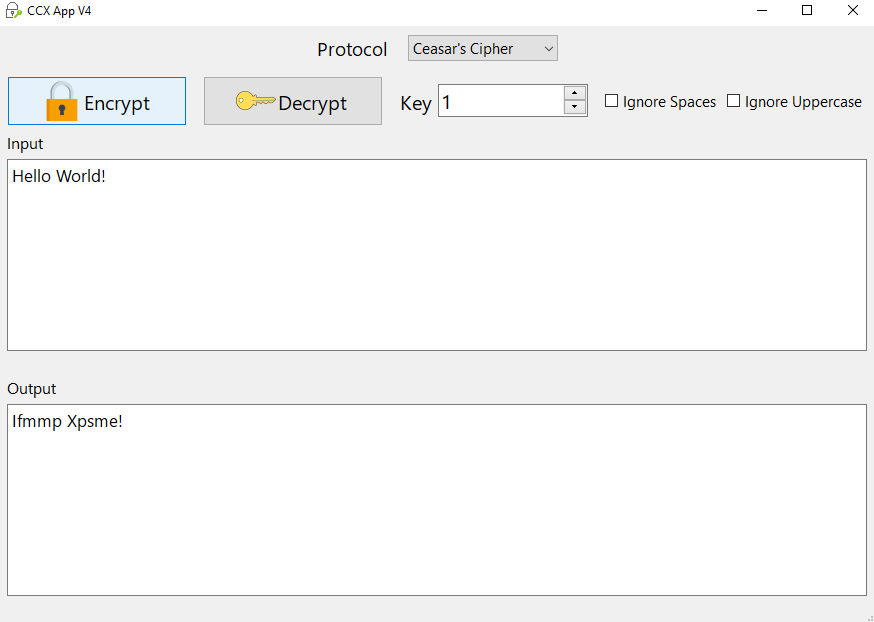
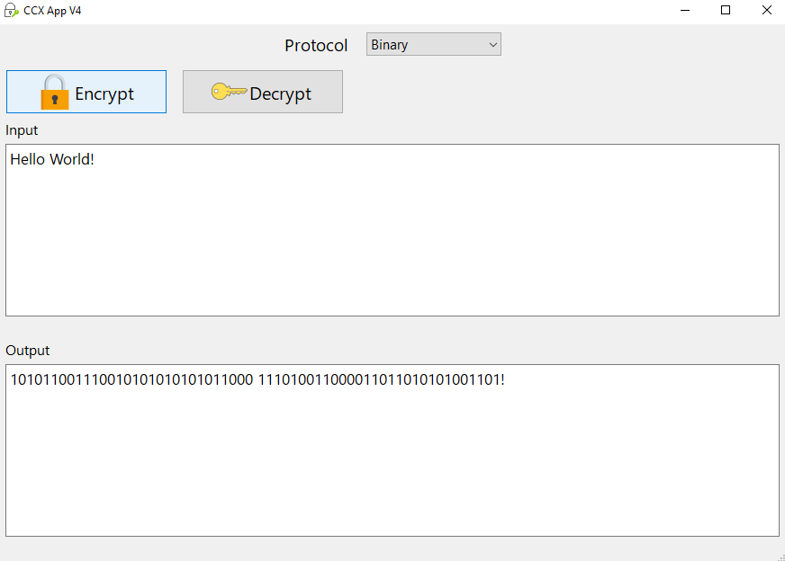

# Text OBDE Tool

A C++ text obfuscation and deobfuscation application developed in two versions: a command-line program and a graphical desktop application built with Qt.

## Overview

This application takes as input english text entered from the user and gives them the choice to "encrypt" (obfuscate) or "decrypt" (deobfuscate) the entered message. It supports 2 ways (in the GUI version) of doing so: using the Ceasar's Cipher, and using a number-letter to binary mapping logic.
This app can be used to add one or more layers of obfuscation to messages sent, offering a basic way to establish a communication that is not easily comprehensible by third parties. It can be used as a fun way to communicate with your friends and family. Feel free to experiment with the code and/or add your own obfuscation methods!

## DISCLAIMER
DISCLAIMER: obfuscation and encryption are not the same! This app does not encrypt messages, rather obfuscates them, meaning that someone who knows the obfuscation process can easily reverse-engineer the process and get to the original message! Please do not rely on this application for encryption - stick to established encryption algorithms instead!

## Features

- Text input and processing (OBfuscation / DEobfuscation)
- Ceasar's Cipher protocol support (both command line - cli and GUI versions)
- Binary (only available in the GUI version for now)
- 2 processing profiles in the Qt version (Ceasar's Cipher and Binary)
- UI version: Option to ignore spaces and capital letters offering more robust obfuscation

## Versions

### 1. Command-Line Version

The original implementation, developed using standard C++.

**Features:**
- Obfuscates and deobfuscates text using the Ceasar's Cipher protocol
- Lacks the "ignore spaces" and "ignore Uppercase" features of the GUI version
- To terminate the input stream, use the mentioned by the app method if using windows command line. If using Linux, try Ctrl + D.

**Technologies:** C++

### 2. Qt GUI Version

An enhanced desktop application featuring a graphical user interface and multiple text-processing profiles.

**Features:**
- Graphical user interface built with Qt Widgets
- Two processing profiles (Ceasar's Cipher and Binary)
- Ceasar's Cipher only shifts the positions of letters, binary supports mapping digits and letters to 6-bit binary values

**Technologies:** C++, Qt Widgets, CMake

## Screenshots

### Ceasar's Cipher Profile



### Binary Profile




## Project Structure

```text
Text-OBDE-tool/
├── cli-version/    # Original command-line implementation
├── qt-version/     # Qt desktop application
└── screenshots/    # Application screenshots
```

## How to Run

### Command-Line Version

1. Compile `cli-version/main.cpp` using a compatible C++ compiler.
2. Run the resulting executable.
3. Follow the instructions on the app.

### Qt GUI Version

**Requirements:**
- Qt 6.11.2 (probably works in other versions as well)
- Qt Creator or another compatible CMake-based build environment
- A compatible C++ compiler

**Steps:**
1. Clone or download this repository.
2. Open `qt-version/CMakeLists.txt` in Qt Creator.
3. Select a compatible Qt kit and configure the project.
4. Build and run the application.

## What I Learned

- Strengthened my C++ skills, especially string manipulation, text processing, and designing functions.
- Acquired hands on experience on the modularity and separating functionality into reusable components of application development and deployment of windows apps.
- Qt Widgets, basic GUI development, allowing users to customize application behavior through interactive controls.
- Gained introductory experience on protocols for obfuscating text.

## Future Improvements

- Add obfuscation of special characters and other languages (apart from english).
- Adding new obfuscation profiles.

## License

This app is currently shared under no licence. Feel free to play around with the code and experiment with your own features!
